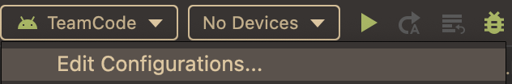
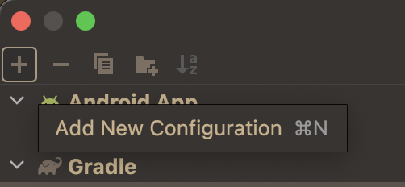
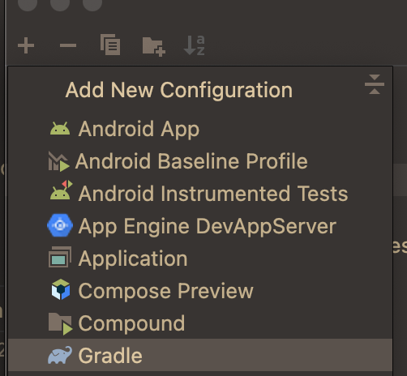
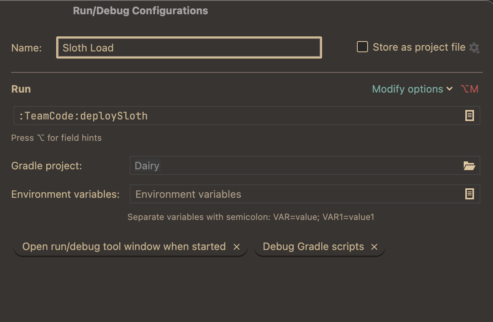
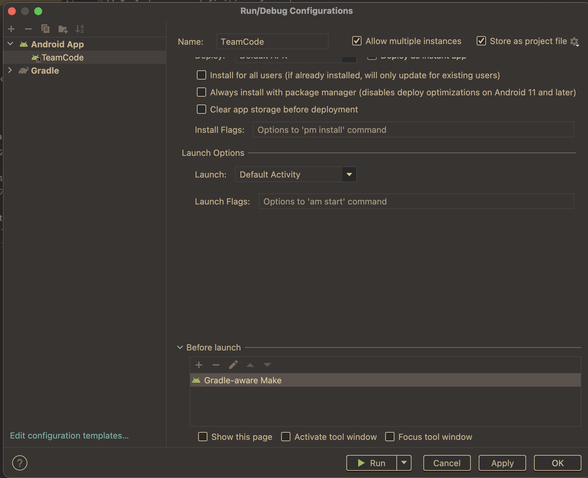
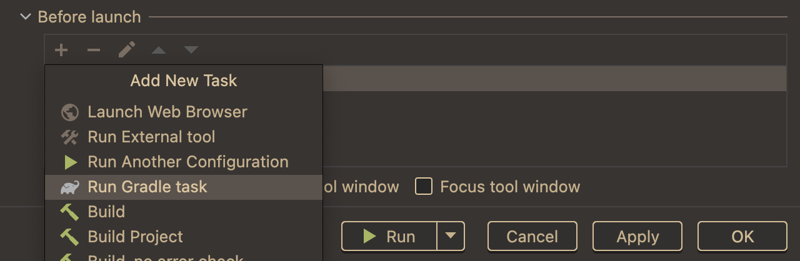
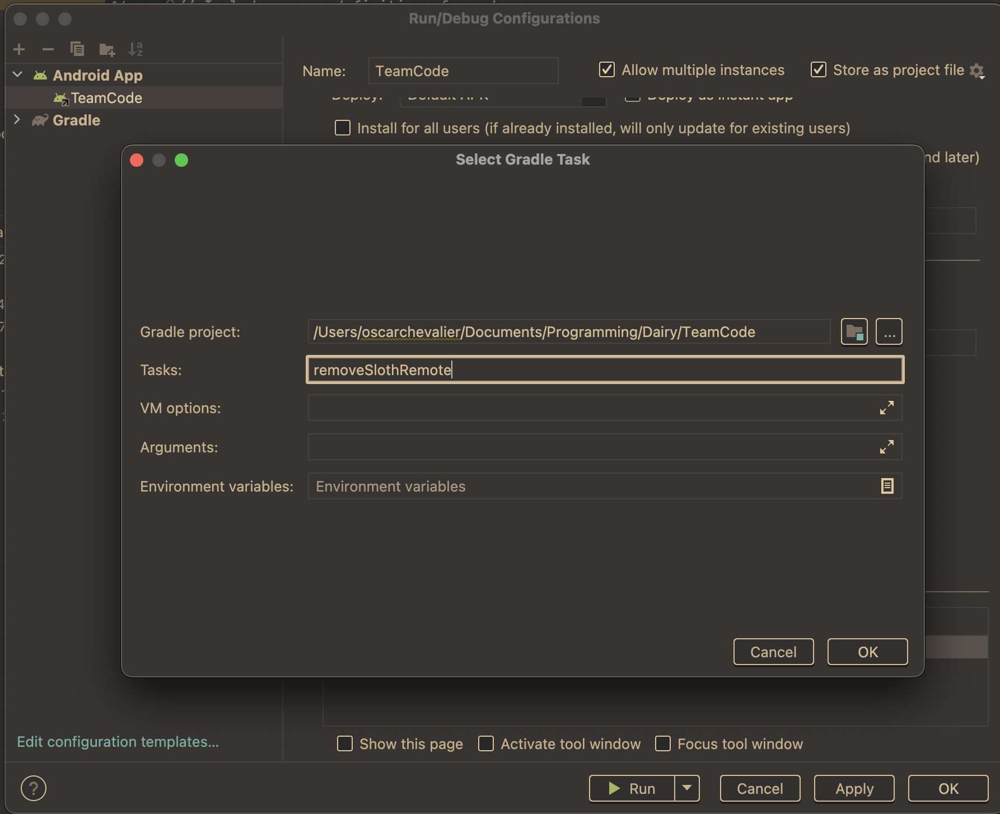
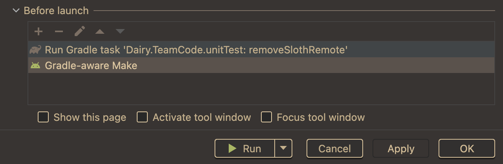

# Sloth

<a href="https://repo.dairy.foundation/#/releases/dev/frozenmilk/sinister/Sloth" target="_blank">

</a>

Sloth is the fastest hot code reload library for FTC.

Hot reloading involves sending only your teamcode to the robot when you make a
change, to get *very* fast Write -> Run -> Test development cycles. Say goodbye to
waiting 40+ seconds for your teamcode to be uploaded, Sloth gets code on your
robot in ***under a second***.

Sloth is also a [Sinister](https://docs.dairy.foundation/Sinister/overview)
runtime that enables the use of Sinister's classpath scanning and dynamic
loading capabilities on the android FTC platform. This allows Sloth to
support a wide range of libraries that need to know about and react to hot
reloading your code.

Sloth has some major improvements over its predecessor,
[fastload](https://github.com/MatthewOates36/fast-load):
1. Sloth is **much faster** than fastload. fastload advertises ~7 seconds upload
   time; Sloth has a upper ceiling of 2 seconds, but often is less than 1.
3. Sloth will **keep changes across restarts and power cycles of the robot**.
4. Sloth only processes the change in code when your OpMode ends, which means
   **it is safe to deploy with Sloth while running other code**.
6. `@Pinned` can be put on classes to prevent dynamically changing it, or any
   subclasses of it.
7. Sloth is a more capable runtime, that does more than just swap over your
   code:
    - Sloth sets up [Dairy](https://docs.dairy.foundation/introduction).
    - Sloth updates parts of the SDK properly when you upload code changes,
      including your hardwaremap if you're uploading drivers with your teamcode
      (e.g. the goBILDA Pinpoint driver before it was part of the SDK).
    - Libraries that rely on looking at your code, like [FTC
      Dashboard](https://github.com/acmerobotics/ftc-dashboard), can be easily
      tweaked to be compatible with Sloth, and thus load faster, and support
      hotreloading. (Please open an issue if you have a favourite library that
      is currently incompatible with Sloth; I don't mind maintaining a fork, or
      doing the setup work to make it easy for others to maintain.)
    - Sloth supports custom user classpath scanning, so you can write your own
      systems that listen and react to hot reloads.
8. Sloth includes a drop-in replacement of FTC Dashboard and Panels that
   replaces some internal mechanisms of FTC Dashboard / Panels to use the Sloth
   and Sinister equivalents. This fork fully supports hot reloading for
   Configuration (`@Config`) and OpModes.

There are some precautions to take when using Sloth:
1. Sloth will only dynamically hot reload classes in the
   `org.firsinspires.ftc.teamcode` package (and subpackages).
2. It is possible to upload code that compiles, but does not work when hot
   reloaded due to:
   - Installing or changing libraries.
   - Changing files that are not hot reloaded.
   - Changing `@Pinned` on files.
   Be careful to ensure that you make changes that will be changed, and if make
   changes that will not, that you perform a full install in order to propagate
   them.

# Installation

> [!CAUTION]
> Make sure to read the installation instructions carefully, do not skim them
> and guess at what to do. The instructions are precise, and many teams have
> issues installing Sloth due to misreading the installation instructions.

> [!NOTE]
> If you are using FTC Dashboard, check out the [FTC Dashboard](#ftc-dashboard)
> section.

> [!NOTE]
> If you are using Panels, the sloth panels patches have now been ported
> upstream, so install the latest version of panels.

If you're interested in an easier way to manage your ftc gradle build and
dependencies, check out [Dairy Templates](#dairy-templates-project), which have
a template for using Sloth with all the work done for you.

Otherwise, teams using the standard sdk project setup should skip [Dairy
Templates](#dairy-templates-project) and continue to [Standard
SDK](#standard-sdk-project).

## Dairy Templates Project

> [!CAUTION]
> Do not follow these steps unless you are already using a Dairy project
> template.

We maintain some plugins and templates that make setting up FTC projects very
easy for teams, and makes it easy to keep all your ftc libraries up to date and
in sync.

Learn more about Dairy's gradle plugins and project templates
[here](https://github.com/Dairy-Foundation/Templates/)

If you're using the [Dairy gradle
plugins](https://github.com/Dairy-Foundation/Plugins) this process is well
supported:

you can find an example
[here](https://github.com/Dairy-Foundation/Templates/tree/teamcode-sloth).

```kts
ftc {
    dairy {
        implementation(Sloth)
        // if you want slothboard too
        implementation(slothboard)
        // if you want panels too
        implementation(ftControl.fullpanels)
    }
}
```
You do not need to worry about excluding dashboard from roadrunner, it has
already been done.

You do not need to add the repositories either.

You do need to install the Load plugin:

```kts
plugins {
    // you should already have this line
    id("dev.frozenmilk.teamcode") version "12.0.0-1.2.2"
    // add this line
    id("dev.frozenmilk.sinister.sloth.load") version "0.3.2"
}
```

Then follow the steps to set up the gradle tasks.

## Standard SDK Project

If you have a standard SDK project, follow the instructions below to add the
libraries and plugins you will need.

### Dairy Repositories
Add the dairy repositories to your `TeamCode` `build.gradle`, above the
`dependencies` block:
```groovy
repositories {
    // Dairy releases repository
    maven {
        url = "https://repo.dairy.foundation/releases"
    }
}
```

### Sloth Library
Add sloth to the `dependencies` block:
```groovy
dependencies {
    implementation("dev.frozenmilk.sinister:Sloth:0.3.2")
}
```

Now [install the Load plugin](#load-plugin).

### Load Plugin
Add this to the top of your `TeamCode` `build.gradle`:
```groovy
buildscript {
    repositories {
        mavenCentral()
        google()
        maven {
            url "https://repo.dairy.foundation/releases"
        }
    }
    dependencies {
        classpath "dev.frozenmilk:Load:0.3.2"
    }
}
```

Add this after the `apply plugin:` lines in the same file:
```groovy
// there should be 2 or 3 more lines that start with 'apply plugin:' here
apply plugin: 'dev.frozenmilk.sinister.sloth.load'
```

Before you move on, check if you need to swap or update any of your other
libraries to Sloth versions, like dashboard or panels. Regular versions of
libraries that have Sloth vesions are not expected to work under Sloth.

Sync and upload the code onto your robot via standard install, not the sloth
install that you are about to set up.

Now [add the Gradle tasks](#gradle-tasks).

### FTC Dashboard

Add slothboard to the `dependencies` block, removing any dependency on the
original dashboard you had.
```groovy
dependencies {
    implementation("com.acmerobotics.slothboard:dashboard:0.3.2+0.6.0")
}
```

> [!NOTE]
> If you use a library that imports dashboard via a `implementation` or `api`
> dependency, ask the library maintainers to consider changing it to
> `compileOnly`.  This will allow it to work with the modified version of FTC
> Dashboard that Sloth uses.

If you use roadrunner, you will need to exclude dashboard so that it does not
collide with slothboard:

Change the `implementation` like so:
```groovy
implementation("com.acmerobotics.roadrunner:ftc:0.1.25") {
   exclude group: "com.acmerobotics.dashboard"
}
implementation ("com.acmerobotics.roadrunner:actions:1.0.1"){
   exclude group: "com.acmerobotics.dashboard"
}
```

_Road Runner version numbers may not be up to date; they are provided only as an
example._

### Panels

Panels has now incorporated the changes required to use Sloth into the library
since fullpanels version 1.0.16, as such, there is no more slothpanels. Old
publications of slothpanels still exist, and you can find them
[here](https://repo.dairy.foundation/#/releases/com/bylazar/sloth).

## Gradle Tasks

Edit configurations:



Add new configuration:



Select gradle:



Add `deploySloth` and save it:


NOTE: android studio will not auto complete the names of these tasks, just write
it and it will work.

Edit TeamCode configuration:



Add new gradle task:



Add `removeSlothRemote`:



Note: Type `:TeamCode` into the `Gradle Project` box to get the right contents,
**do not copy mine**.

Put `removeSlothRemote` first and save:



Run the deploySloth task you just added to deploy the code.

Congratulations!  You are now set up with lightning-fast software deployment
using Sloth.

## Trouble Shooting / Known Bugs

### OnBotJava / External Libraries

Version 0.3.2 of Sloth is unable to load OnBotJava files or External Libraries,
and will crash if there are any, with a warning about being unable to load a
class. You can fix this by removing all OnBotJava and External Libraries files
from the Program and Manage page of the control hub.

Sometimes you cannot see all the files in the Program and Manage page, in which
case you can remove the files via the device file explorer that is available in
Android Studio while adb connected to the robot.

Remove all files in the following directories:
```
/storage/emulated/0/FIRST/ExternalLibraries/
/storage/emulated/0/FIRST/java/src/
/storage/emulated/0/FIRST/java/srcBackups/
/storage/emulated/0/FIRST/java/build/jars/
```
